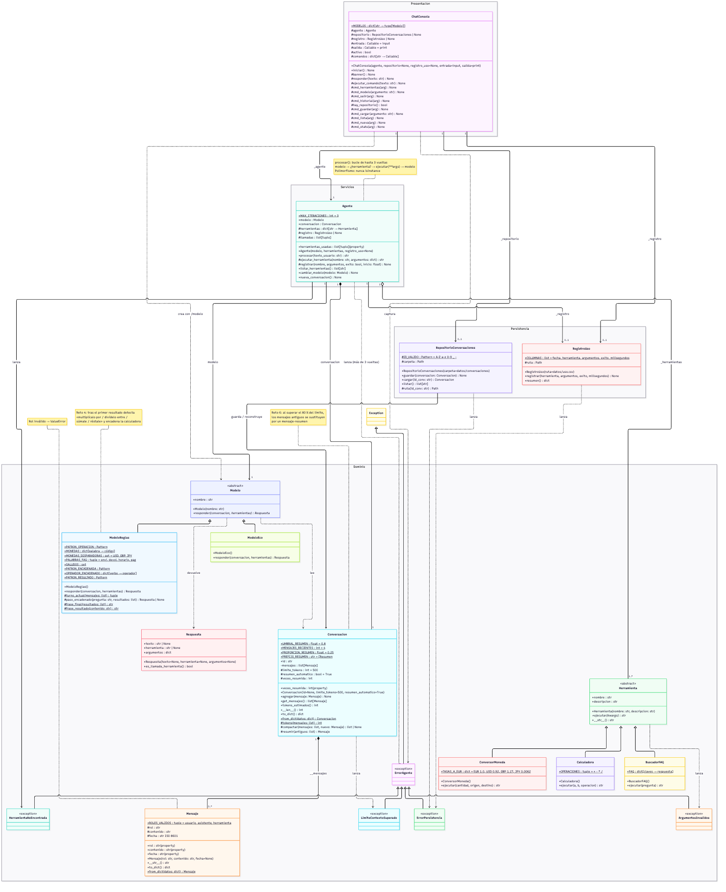
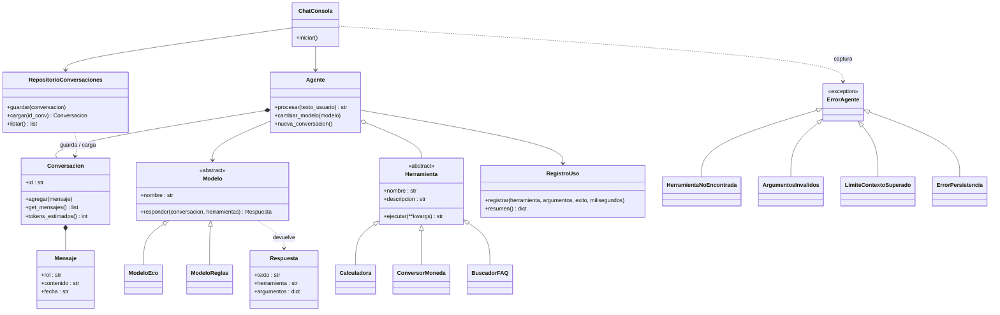

# NEXO · asistente de TechNova (Nivel 3: agente pro)

Agente de IA "de juguete" en Python con arquitectura por capas. El programa solo usa la biblioteca estándar; `pytest` hace falta solo para las pruebas.

## Ejecución

```bash
python3 -m venv .venv && source .venv/bin/activate
pip install -r requirements.txt   # pytest
python main.py                    # desde la raíz del proyecto
pytest                            # pruebas (65)
```

## Estructura

| Capa | Archivos |
|---|---|
| Presentación | `presentacion/chat_consola.py` |
| Servicios | `servicios/agente.py` |
| Dominio | `dominio/excepciones.py`, `mensaje.py`, `herramientas.py`, `modelos.py` |
| Persistencia | `persistencia/repositorio_conversaciones.py`, `registro_uso.py` |
| Conexión | `main.py` (único sitio donde se unen las piezas) |

No hay `print()` ni `input()` en `dominio/` ni `servicios/` (lo verifica una prueba).

## Comandos del chat

| Comando | Acción |
|---|---|
| texto normal | Se envía a NEXO |
| `/herramientas` | Lista las herramientas |
| `/modelo eco` · `/modelo reglas` | Cambia de modelo en caliente |
| `/historial` | Mensajes, roles y tokens estimados |
| `/guardar` | Guarda la conversación actual e informa de su id |
| `/cargar <id>` | Restaura una conversación completa en el agente |
| `/lista` | Conversaciones guardadas |
| `/nueva` | Nueva conversación (con id nuevo; las guardadas no se tocan) |
| `/stats` | Resumen del registro de uso |
| `/salir` | Termina |

Los errores (`ErrorAgente` y derivadas, o cualquier fallo inesperado) se muestran como mensaje y el chat sigue abierto.

## Persistencia JSON

`RepositorioConversaciones(carpeta="datos/conversaciones")` guarda cada conversación en `<id>.json`
(`to_dict()`, UTF-8, escritura atómica) y la reconstruye con `Conversacion.from_dict()` / `Mensaje.from_dict()`,
conservando id, fechas, roles, contenidos y orden. Los ids solo admiten `A-Z a-z 0-9 _ -`, así que no se puede
salir de la carpeta (`../x`). Id inexistente, JSON corrupto o contenido inválido lanzan `ErrorPersistencia`
(subclase de `ErrorAgente`).

## Registro CSV

`RegistroUso("datos/uso.csv")` añade una fila por ejecución de herramienta, éxito o fallo:
`fecha,herramienta,argumentos,exito,milisegundos` (cabecera una sola vez, duración medida con `perf_counter`).
`resumen()` devuelve `{"total", "usos", "fallos"}` (a cero si no hay registros). El agente funciona igual con `registro_uso=None`.

## Retos del Nivel 3

### Reto 4: varias herramientas en una pregunta
«convierte 100 USD a euros y multiplícalo por 3» → `conversor_moneda` → `calculadora` → respuesta:
`Primero, 100 USD = 92.00 EUR; después, 92 * 3 = 276.`

**El agente no se ha modificado.** Su bucle ya permite hasta 3 vueltas. Es `ModeloReglas` quien, al ver el
primer resultado, detecta una segunda operación en la pregunta («multiplícalo por», «divídelo entre»,
«súmale», «réstale») y pide otra herramienta con el número del resultado anterior. Si el primer paso falla,
no encadena.

### Reto 5: tests con `pytest`
La carpeta `tests/` replica la estructura del proyecto:

```
tests/
├── dominio/        test_excepciones · test_mensaje · test_herramientas · test_modelos
├── servicios/      test_agente
├── persistencia/   test_repositorio_conversaciones · test_registro_uso
├── presentacion/   test_chat_consola
├── test_main.py          ← main.py (ciclo real guardar → cerrar → reabrir → cargar)
├── test_arquitectura.py  ← reglas globales: sin print/input en dominio/servicios, sin isinstance en el agente
└── ayudantes.py          ← crear_agente(), ejecutar_chat()
```

El dominio se puede probar sin entrada ni salida porque no tiene `input()` ni `print()`. El chat se prueba
inyectando `entrada`/`salida` en `ChatConsola`.

### Reto 6: resumen automático
Cuando `Conversacion.agregar()` detecta que se superaría el **80 %** del límite de tokens, sustituye los
mensajes antiguos por un único mensaje-resumen (`[Resumen de N mensajes anteriores] Temas: …`) y conserva
intactos los más recientes (hasta 4, o menos si hace falta para bajar del 80 %).
- El resumen recoge las preguntas del usuario y arrastra los temas de resúmenes anteriores, sin anidarlos.
- Ocupa como máximo el 25 % del límite: los temas más antiguos se van descartando.
- Si ni resumiendo cabe el mensaje (por ejemplo, uno enorme), se lanza `LimiteContextoSuperado` y la
  conversación no cambia.
- El chat avisa con `🗜 He resumido los mensajes antiguos…`.
- Se puede desactivar con `Conversacion(resumen_automatico=False)`.

## Diagrama de clases

Solo aparecen los métodos públicos principales. Los detalles están en el código de cada clase.



<details>
<summary>Código Mermaid (GitHub lo dibuja; también se puede pegar en mermaid.live)</summary>



</details>

**Cómo leerlo:**
- **Herencia** (`<|--`): los 3 tipos de herramienta, los 2 modelos y las 4 excepciones heredan de su clase base. El agente usa herramientas y modelos a través de la base, sin saber cuál es cuál (polimorfismo).
- **Composición** (`*--`): el `Agente` crea **su** `Conversacion`, y la `Conversacion` está formada por `Mensaje`s.
- **Agregación** (`o--`): el `Agente` usa herramientas que se crean **fuera**, en `main.py`.
- **Asociación** (`-->`): una clase guarda una referencia a otra.
- **Dependencia** (`..>`): una clase devuelve, guarda o captura algo de otra.
- Las capas solo dependen hacia abajo: Presentación → Servicios → Dominio, y Persistencia → Dominio. `main.py` las conecta todas.

## Nivel alcanzado y uso de la IA

- Nivel alcanzado: 3, con los retos 4 (varias herramientas), 5 (pytest) y 6 (resumen automático).
- Uso de la IA (asistente: Claude Code):
  - El código del proyecto se generó con la IA a partir del enunciado.
  - El diagrama de clases: la IA hizo una primera versión detallada y después, a petición nuestra, una versión simplificada.
  - Los comentarios de una línea encima de cada función los añadió la IA.
  - Las preguntas de reflexión: respondí con mis ideas y la IA me dio pistas sobre el código. Al final, por falta de tiempo, le pedí que redactara las respuestas ampliando lo que yo había contestado.
  - Lo usé también para entender conceptos (`@property`, dónde se crea el `Agente`, para qué sirve `ModeloEco`).
  - **Pendiente:** qué cambiamos nosotros de lo que propuso la IA.

## Preguntas de reflexión de Zadkiel De Jesus

**1. En el Tema 2 conectaréis un LLM real. ¿Qué clase o clases tendréis que crear y cuáles tendréis que modificar? ¿Por qué?**

*Respuesta:* Habría que crear una clase nueva, por ejemplo `ModeloLLM`, que herede de `Modelo` e implemente `responder()`: ahí se hace la llamada a la API y lo que contesta se convierte en una `Respuesta` (un texto final o una herramienta con sus argumentos). Solo cambiaría `main.py`, para arrancar con `ModeloLLM`, y el diccionario `MODELOS` de `chat_consola.py` si quiero elegirlo con `/modelo`. El `Agente` no se toca, porque solo conoce la clase base `Modelo` y llama a `responder()` sin saber qué modelo es. Eso es polimorfismo: ya pasa con `ModeloEco` y `ModeloReglas`.

**2. ¿Por qué `get_mensajes()` devuelve una copia de la lista y no la lista original? ¿Qué podría pasar si no?**

*Respuesta:* Porque si devolviera la lista original, cualquiera podría hacer `.append()` o `.clear()` sobre ella sin pasar por `agregar()`. Así se saltaría el límite de tokens y el resumen automático del reto 6, y la conversación podría quedar en un estado inválido sin que la clase se entere. Con la copia, lo que hagan con esa lista no afecta al historial real.

**3. El modelo pide la herramienta, pero quien la ejecuta es el agente. ¿Por qué creéis que las APIs de IA reales funcionan así? (Pensad en la seguridad.)**

*Respuesta:* Por seguridad: si el modelo pudiera ejecutar código por su cuenta, un error suyo o un texto malicioso que lo engañe podría romper cosas en el ordenador, borrar archivos o hacer acciones que nadie pidió. En cambio, el modelo solo pide la herramienta y el agente decide: comprueba que la herramienta existe, que los argumentos son válidos, registra cada uso en el CSV y corta a las 3 vueltas para que no se quede en bucle gastando recursos. El control lo tiene siempre nuestro código, no la IA.

**4. ¿En qué se parece vuestro `BuscadorFAQ` a un sistema RAG? ¿Qué limitaciones tiene buscar por palabras en común?**

*Respuesta:* Se parece en que, antes de responder, busca información en una base de conocimiento (el diccionario `FAQ`) y esa respuesta se le pasa al modelo para que conteste con ella, que es la idea de RAG. La limitación es que solo cuenta palabras iguales: no entiende sinónimos ni el significado. Por ejemplo, "¿cuándo me llega el pedido?" no comparte ninguna palabra con las claves de envíos, así que no la encuentra. Además, si hay empate gana la primera. Un RAG real usa embeddings, que comparan el significado de las frases y no solo las palabras.

**5. Si mañana TechNova quiere el chat en una web con React, ¿qué carpetas del proyecto se quedarían exactamente igual?**

*Respuesta:* Se quedarían exactamente igual `dominio/`, `servicios/` y `persistencia/`, porque ninguna usa `input()` ni `print()` (lo comprueba `test_arquitectura.py`). Solo cambiaría `presentacion/`: en lugar de `ChatConsola` haría falta una pequeña API web (por ejemplo con Flask o FastAPI) que reciba los mensajes del front en React y llame a `agente.procesar()`. También cambiaría `main.py`, que arrancaría esa API en vez del chat de consola.
