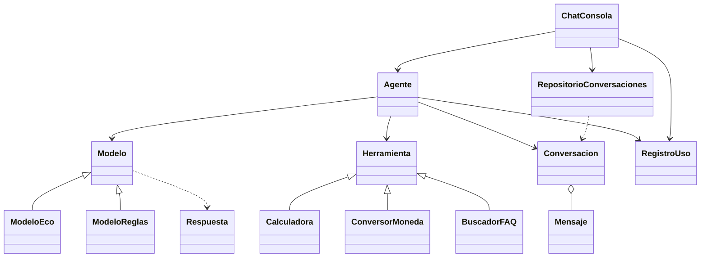

# NEXO · asistente de TechNova (Nivel 2: agente con memoria)

Agente de IA "de juguete" en Python (solo biblioteca estándar) con arquitectura por capas.

## Ejecución

```bash
python main.py            # desde la raíz del proyecto (carpeta nexo/)
python -m unittest discover -v   # pruebas
```

## Estructura

| Capa | Archivos |
|---|---|
| Presentación | `presentacion/chat_consola.py` |
| Servicios | `servicios/agente.py` |
| Dominio | `dominio/excepciones.py`, `mensaje.py`, `herramientas.py`, `modelos.py` |
| Persistencia | `persistencia/repositorio_conversaciones.py`, `registro_uso.py` |
| Conexión | `main.py` (único sitio donde se unen las piezas) |

No hay `print()` ni `input()` en `dominio/` ni `servicios/` (lo verifica una prueba).

## Comandos del chat

| Comando | Acción |
|---|---|
| texto normal | Se envía a NEXO |
| `/herramientas` | Lista las herramientas |
| `/modelo eco` · `/modelo reglas` | Cambia de modelo en caliente |
| `/historial` | Mensajes, roles y tokens estimados |
| `/guardar` | Guarda la conversación actual e informa de su id |
| `/cargar <id>` | Restaura una conversación completa en el agente |
| `/lista` | Conversaciones guardadas |
| `/nueva` | Nueva conversación (con id nuevo; las guardadas no se tocan) |
| `/stats` | Resumen del registro de uso |
| `/salir` | Termina |

Los errores (`ErrorAgente` y derivadas, o cualquier fallo inesperado) se muestran como mensaje y el chat sigue abierto.

## Persistencia JSON

`RepositorioConversaciones(carpeta="datos/conversaciones")` guarda cada conversación en `<id>.json`
(`to_dict()`, UTF-8, escritura atómica) y la reconstruye con `Conversacion.from_dict()` / `Mensaje.from_dict()`,
conservando id, fechas, roles, contenidos y orden. Los ids solo admiten `A-Z a-z 0-9 _ -`, así que no se puede
salir de la carpeta (`../x`). Id inexistente, JSON corrupto o contenido inválido lanzan `ErrorPersistencia`
(subclase de `ErrorAgente`).

## Registro CSV

`RegistroUso("datos/uso.csv")` añade una fila por ejecución de herramienta, éxito o fallo:
`fecha,herramienta,argumentos,exito,milisegundos` (cabecera una sola vez, duración medida con `perf_counter`).
`resumen()` devuelve `{"total", "usos", "fallos"}` (a cero si no hay registros). El agente funciona igual con `registro_uso=None`.

## Pruebas (`tests/test_nexo.py`, `unittest`)

Cubren: ejemplo de ejecución del Nivel 1, encapsulación y límite de tokens, límite de 3 iteraciones, herramienta
inexistente, guardar/cargar completo, ids maliciosos y JSON corrupto, comandos `/lista` `/nueva` `/historial`,
CSV con éxitos y fallos, `/stats`, ausencia de `print`/`input`/`isinstance`, y un ciclo real
guardar → cerrar → reabrir `main.py` → cargar.

## Diagrama de clases



## Nivel alcanzado y uso de la IA

- Nivel alcanzado: 2 (sin retos del Nivel 3).
- Uso de la IA: este código fue generado con un asistente de IA a partir del enunciado.
  **Pendiente de completar por la pareja:** qué se pidió a la IA, qué se cambió y las respuestas a las
  preguntas de reflexión (deben ir con vuestras palabras, según la sección 11 del enunciado).
