# NEXO · asistente de TechNova (Nivel 3: agente pro)

Agente de IA "de juguete" en Python con arquitectura por capas. El programa solo usa la biblioteca estándar; `pytest` hace falta solo para las pruebas.

## Ejecución

```bash
python3 -m venv .venv && source .venv/bin/activate
pip install -r requirements.txt   # pytest
python main.py                    # desde la raíz del proyecto
pytest                            # pruebas (65)
```

## Estructura

| Capa | Archivos |
|---|---|
| Presentación | `presentacion/chat_consola.py` |
| Servicios | `servicios/agente.py` |
| Dominio | `dominio/excepciones.py`, `mensaje.py`, `herramientas.py`, `modelos.py` |
| Persistencia | `persistencia/repositorio_conversaciones.py`, `registro_uso.py` |
| Conexión | `main.py` (único sitio donde se unen las piezas) |

No hay `print()` ni `input()` en `dominio/` ni `servicios/` (lo verifica una prueba).

## Comandos del chat

| Comando | Acción |
|---|---|
| texto normal | Se envía a NEXO |
| `/herramientas` | Lista las herramientas |
| `/modelo eco` · `/modelo reglas` | Cambia de modelo en caliente |
| `/historial` | Mensajes, roles y tokens estimados |
| `/guardar` | Guarda la conversación actual e informa de su id |
| `/cargar <id>` | Restaura una conversación completa en el agente |
| `/lista` | Conversaciones guardadas |
| `/nueva` | Nueva conversación (con id nuevo; las guardadas no se tocan) |
| `/stats` | Resumen del registro de uso |
| `/salir` | Termina |

Los errores (`ErrorAgente` y derivadas, o cualquier fallo inesperado) se muestran como mensaje y el chat sigue abierto.

## Persistencia JSON

`RepositorioConversaciones(carpeta="datos/conversaciones")` guarda cada conversación en `<id>.json`
(`to_dict()`, UTF-8, escritura atómica) y la reconstruye con `Conversacion.from_dict()` / `Mensaje.from_dict()`,
conservando id, fechas, roles, contenidos y orden. Los ids solo admiten `A-Z a-z 0-9 _ -`, así que no se puede
salir de la carpeta (`../x`). Id inexistente, JSON corrupto o contenido inválido lanzan `ErrorPersistencia`
(subclase de `ErrorAgente`).

## Registro CSV

`RegistroUso("datos/uso.csv")` añade una fila por ejecución de herramienta, éxito o fallo:
`fecha,herramienta,argumentos,exito,milisegundos` (cabecera una sola vez, duración medida con `perf_counter`).
`resumen()` devuelve `{"total", "usos", "fallos"}` (a cero si no hay registros). El agente funciona igual con `registro_uso=None`.

## Retos del Nivel 3

### Reto 4: varias herramientas en una pregunta
«convierte 100 USD a euros y multiplícalo por 3» → `conversor_moneda` → `calculadora` → respuesta:
`Primero, 100 USD = 92.00 EUR; después, 92 * 3 = 276.`

**El agente no se ha modificado.** Su bucle ya permite hasta 3 vueltas. Es `ModeloReglas` quien, al ver el
primer resultado, detecta una segunda operación en la pregunta («multiplícalo por», «divídelo entre»,
«súmale», «réstale») y pide otra herramienta con el número del resultado anterior. Si el primer paso falla,
no encadena.

### Reto 5: tests con `pytest`
La carpeta `tests/` replica la estructura del proyecto:

```
tests/
├── dominio/        test_excepciones · test_mensaje · test_herramientas · test_modelos
├── servicios/      test_agente
├── persistencia/   test_repositorio_conversaciones · test_registro_uso
├── presentacion/   test_chat_consola
├── test_main.py          ← main.py (ciclo real guardar → cerrar → reabrir → cargar)
├── test_arquitectura.py  ← reglas globales: sin print/input en dominio/servicios, sin isinstance en el agente
└── ayudantes.py          ← crear_agente(), ejecutar_chat()
```

El dominio se puede probar sin entrada ni salida porque no tiene `input()` ni `print()`. El chat se prueba
inyectando `entrada`/`salida` en `ChatConsola`.

### Reto 6: resumen automático
Cuando `Conversacion.agregar()` detecta que se superaría el **80 %** del límite de tokens, sustituye los
mensajes antiguos por un único mensaje-resumen (`[Resumen de N mensajes anteriores] Temas: …`) y conserva
intactos los más recientes (hasta 4, o menos si hace falta para bajar del 80 %).
- El resumen recoge las preguntas del usuario y arrastra los temas de resúmenes anteriores, sin anidarlos.
- Ocupa como máximo el 25 % del límite: los temas más antiguos se van descartando.
- Si ni resumiendo cabe el mensaje (por ejemplo, uno enorme), se lanza `LimiteContextoSuperado` y la
  conversación no cambia.
- El chat avisa con `🗜 He resumido los mensajes antiguos…`.
- Se puede desactivar con `Conversacion(resumen_automatico=False)`.

## Diagrama de clases

**Notación** (UML):
| Símbolo | Significado | En Python |
|---|---|---|
| `+` | público | `nombre` |
| `#` | protegido | `_nombre` |
| `-` | privado | `__nombre` (*name mangling*) |

En el diagrama los nombres van sin el guion bajo inicial: lo indica el símbolo. `#ruta` es `_ruta` en el código y `-mensajes` es `__mensajes`.
| `$` al final | de clase / estático | constantes de clase, `@staticmethod`, `@classmethod` |
| `*` al final | abstracto | lanza `NotImplementedError`: cada hija lo implementa |
| `(property)` | se lee como atributo | `@property` |
| `NombreClase(...)` | constructor | `__init__(...)` |

```mermaid
classDiagram
    direction TB

    %% =====================  PRESENTACIÓN  =====================
    namespace Presentacion {
        class ChatConsola {
            +MODELOS : dict[str → type[Modelo]]$
            #agente : Agente
            #repositorio : RepositorioConversaciones | None
            #registro : RegistroUso | None
            #entrada : Callable = input
            #salida : Callable = print
            #activo : bool
            #comandos : dict[str → Callable]
            +ChatConsola(agente, repositorio=None, registro_uso=None, entrada=input, salida=print)
            +iniciar() None
            #banner() None
            #responder(texto: str) None
            #ejecutar_comando(texto: str) None
            #cmd_herramientas(arg) None
            #cmd_modelo(argumento: str) None
            #cmd_salir(arg) None
            #cmd_historial(arg) None
            #hay_repositorio() bool
            #cmd_guardar(arg) None
            #cmd_cargar(argumento: str) None
            #cmd_lista(arg) None
            #cmd_nueva(arg) None
            #cmd_stats(arg) None
        }
    }

    %% =====================  SERVICIOS  =====================
    namespace Servicios {
        class Agente {
            +MAX_ITERACIONES : int = 3$
            +modelo : Modelo
            +conversacion : Conversacion
            #herramientas : dict[str → Herramienta]
            #registro : RegistroUso | None
            #llamadas : list[tuple]
            +herramientas_usadas : list[tuple] (property)
            +Agente(modelo, herramientas, registro_uso=None)
            +procesar(texto_usuario: str) str
            #ejecutar_herramienta(nombre: str, argumentos: dict) str
            #registrar(nombre, argumentos, exito: bool, inicio: float) None
            +listar_herramientas() list[str]
            +cambiar_modelo(modelo: Modelo) None
            +nueva_conversacion() None
        }
    }

    %% =====================  DOMINIO  =====================
    namespace Dominio {
        class Mensaje {
            +ROLES_VALIDOS : tuple = usuario, asistente, herramienta$
            #rol : str
            #contenido : str
            #fecha : str ISO 8601
            +rol : str (property)
            +contenido : str (property)
            +fecha : str (property)
            +Mensaje(rol: str, contenido: str, fecha=None)
            +#95;#95;str#95;#95;() str
            +to_dict() dict
            +from_dict(datos: dict) Mensaje$
        }
        class Conversacion {
            +UMBRAL_RESUMEN : float = 0.8$
            +MENSAJES_RECIENTES : int = 4$
            +PROPORCION_RESUMEN : float = 0.25$
            +PREFIJO_RESUMEN : str = [Resumen$
            +id : str
            -mensajes : list[Mensaje]
            #limite_tokens : int = 500
            #resumen_automatico : bool = True
            #veces_resumida : int
            +veces_resumida : int (property)
            +Conversacion(id=None, limite_tokens=500, resumen_automatico=True)
            +agregar(mensaje: Mensaje) None
            +get_mensajes() list[Mensaje]
            +tokens_estimados() int
            +#95;#95;len#95;#95;() int
            +to_dict() dict
            +from_dict(datos: dict) Conversacion$
            #tokens(mensajes: list) int$
            #compactar(mensajes: list, nuevo: Mensaje) list | None
            #resumir(antiguos: list) Mensaje
        }
        class Herramienta {
            <<abstract>>
            +nombre : str
            +descripcion : str
            +Herramienta(nombre: str, descripcion: str)
            +ejecutar(kwargs) str*
            +#95;#95;str#95;#95;() str
        }
        class Calculadora {
            +OPERACIONES : tuple = + - * /$
            +Calculadora()
            +ejecutar(a, b, operacion) str
        }
        class ConversorMoneda {
            +TASAS_A_EUR : dict = EUR 1.0, USD 0.92, GBP 1.17, JPY 0.0062$
            +ConversorMoneda()
            +ejecutar(cantidad, origen, destino) str
        }
        class BuscadorFAQ {
            +FAQ : dict[claves → respuesta]$
            +BuscadorFAQ()
            +ejecutar(pregunta) str
        }
        class Modelo {
            <<abstract>>
            +nombre : str
            +Modelo(nombre: str)
            +responder(conversacion, herramientas) Respuesta*
        }
        class ModeloEco {
            +ModeloEco()
            +responder(conversacion, herramientas) Respuesta
        }
        class ModeloReglas {
            +PATRON_OPERACION : Pattern$
            +MONEDAS : dict[palabra → código]$
            +MONEDAS_DISPARADORAS : set = USD, GBP, JPY$
            +PALABRAS_FAQ : tuple = envi, devol, horario, pag$
            +SALUDOS : set$
            +PATRON_ENCADENADA : Pattern$
            +OPERADOR_ENCADENADO : dict[verbo → operador]$
            +PATRON_RESULTADO : Pattern$
            +ModeloReglas()
            +responder(conversacion, herramientas) Respuesta
            #turno_actual(mensajes: list) tuple$
            #paso_encadenado(pregunta: str, resultados: list) Respuesta | None
            #frase_final(resultados: list) str$
            #frase_resultado(contenido: str) str$
        }
        class Respuesta {
            +texto : str | None
            +herramienta : str | None
            +argumentos : dict
            +Respuesta(texto=None, herramienta=None, argumentos=None)
            +es_llamada_herramienta() bool
        }
        class ErrorAgente {
            <<exception>>
        }
        class HerramientaNoEncontrada {
            <<exception>>
        }
        class ArgumentosInvalidos {
            <<exception>>
        }
        class LimiteContextoSuperado {
            <<exception>>
        }
        class ErrorPersistencia {
            <<exception>>
        }
    }

    %% =====================  PERSISTENCIA  =====================
    namespace Persistencia {
        class RepositorioConversaciones {
            #ID_VALIDO : Pattern = A-Z a-z 0-9 _ -$
            #carpeta : Path
            +RepositorioConversaciones(carpeta=datos/conversaciones)
            +guardar(conversacion: Conversacion) None
            +cargar(id_conv: str) Conversacion
            +listar() list[str]
            #ruta(id_conv: str) Path
        }
        class RegistroUso {
            +COLUMNAS : list = fecha, herramienta, argumentos, exito, milisegundos$
            #ruta : Path
            +RegistroUso(ruta=datos/uso.csv)
            +registrar(herramienta, argumentos, exito, milisegundos) None
            +resumen() dict
        }
    }

    %% =====================  RELACIONES  =====================
    %% Herencia
    Herramienta <|-- Calculadora
    Herramienta <|-- ConversorMoneda
    Herramienta <|-- BuscadorFAQ
    Modelo <|-- ModeloEco
    Modelo <|-- ModeloReglas
    Exception <|-- ErrorAgente
    ErrorAgente <|-- HerramientaNoEncontrada
    ErrorAgente <|-- ArgumentosInvalidos
    ErrorAgente <|-- LimiteContextoSuperado
    ErrorAgente <|-- ErrorPersistencia

    %% Composición, agregación y asociación
    Agente "1" *-- "1" Conversacion : conversacion
    Conversacion "1" *-- "0..*" Mensaje : __mensajes
    Agente "1" o-- "1..*" Herramienta : _herramientas
    Agente "1" --> "1" Modelo : modelo
    Agente "1" --> "0..1" RegistroUso : _registro
    ChatConsola "1" --> "1" Agente : _agente
    ChatConsola "1" --> "0..1" RepositorioConversaciones : _repositorio
    ChatConsola "1" --> "0..1" RegistroUso : _registro

    %% Dependencias: crea, devuelve o lanza
    Modelo ..> Respuesta : devuelve
    Modelo ..> Conversacion : lee
    ChatConsola ..> Modelo : crea con /modelo
    RepositorioConversaciones ..> Conversacion : guarda / reconstruye
    Herramienta ..> ArgumentosInvalidos : lanza
    Conversacion ..> LimiteContextoSuperado : lanza
    Agente ..> HerramientaNoEncontrada : lanza
    Agente ..> ErrorAgente : lanza (más de 3 vueltas)
    RepositorioConversaciones ..> ErrorPersistencia : lanza
    RegistroUso ..> ErrorPersistencia : lanza
    ChatConsola ..> ErrorAgente : captura

    %% Notas
    note for Agente "procesar(): bucle de hasta 3 vueltas<br>modelo → ¿herramienta? → ejecutar(**args) → modelo<br>Polimorfismo: nunca isinstance"
    note for Conversacion "Reto 6: al superar el 80 % del límite,<br>los mensajes antiguos se sustituyen<br>por un mensaje-resumen"
    note for ModeloReglas "Reto 4: tras el primer resultado detecta<br>«multiplícalo por / divídelo entre /<br>súmale / réstale» y encadena la calculadora"
    note for Mensaje "Rol inválido → ValueError"
```


<details>
<summary>Código Mermaid del diagrama (GitHub lo dibuja; también se puede pegar en mermaid.live)</summary>



</details>

**Cómo leerlo:**
- **Herencia** (`<|--`): las 3 herramientas y los 2 modelos heredan de una clase base **abstracta**. El agente los usa a través de esa base sin saber cuál es cuál (polimorfismo).
- **Composición** (`*--`): las partes no existen fuera del todo. El `Agente` crea **su** `Conversacion`, y la `Conversacion` está formada por `Mensaje`s.
- **Agregación** (`o--`): el `Agente` usa herramientas que se crean **fuera**, en `main.py`.
- **Asociación** (`-->`): una clase guarda una referencia a otra. Los números indican cuántas (`0..1` es opcional).
- **Dependencia** (`..>`): una clase crea, devuelve, lanza o captura algo de otra.
- Las capas solo dependen hacia abajo: Presentación → Servicios → Dominio, y Persistencia → Dominio. `main.py` las conecta todas y no aparece porque no es una clase.

## Nivel alcanzado y uso de la IA

- Nivel alcanzado: 3, con los retos 4 (varias herramientas), 5 (pytest) y 6 (resumen automático).
- Uso de la IA: este código fue generado con un asistente de IA a partir del enunciado.
  **Pendiente de completar por la pareja:** qué se pidió a la IA, qué se cambió y las respuestas a las
  preguntas de reflexión (deben ir con vuestras palabras, según la sección 11 del enunciado).
